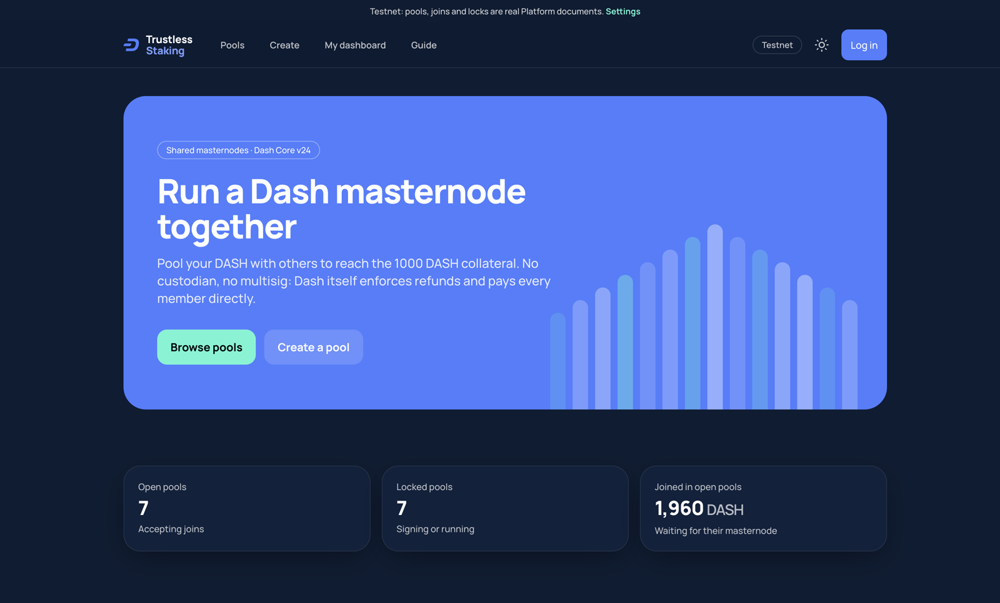
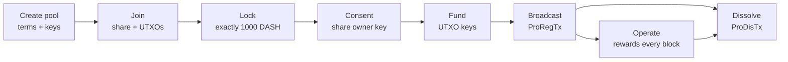
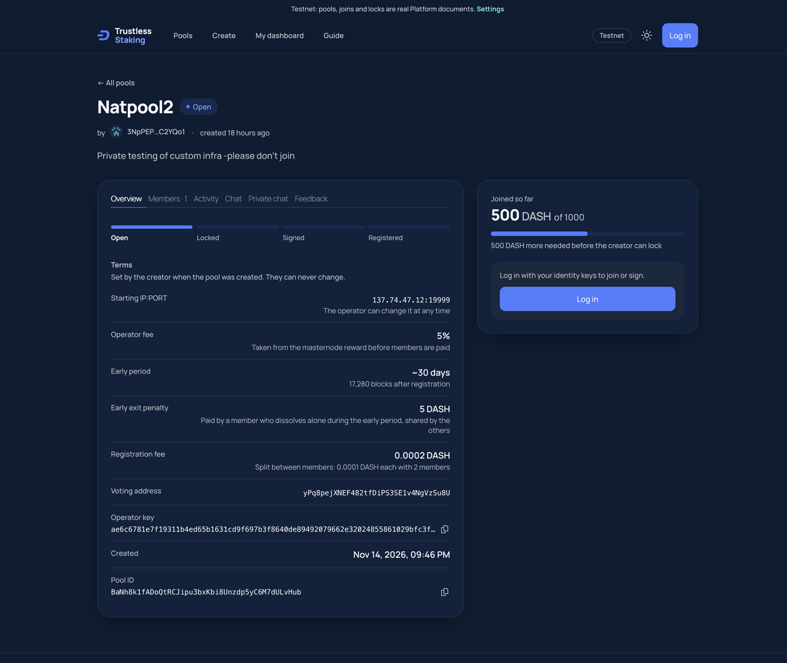

# Dash Trustless Staking



Pool DASH with strangers to run a **Dash masternode** — without a custodian, a multisig, or a server.

Dash Core v24 shared masternodes let 2 to 8 people fund one 1000 DASH masternode together. This is the
dapp that coordinates them: members publish their share, the creator locks the pool, and each member
signs the registration from their own wallet. Dash consensus records every share, pays every reward
straight to its owner, and refunds everyone on dissolution. The pool creator runs the node and votes;
they cannot move anyone's coins.

There is no backend. Coordination documents live in a Dash Platform data contract, chain state comes
from DAPI, and the transaction logic is `dash-core-sdk` — so anyone can build this repo and run it
against the network.

- **Trustless funds.** Refunds, rewards and dissolution are enforced by consensus, not by the app.
- **Keys never touch the dapp.** Every masternode signature comes from the member's wallet.
- **Deterministic registration.** Every client builds the same transaction bytes from the same
  documents; nobody trusts a pasted hex.
- **Leave any time.** Any member can dissolve the pool alone, paying the early-exit penalty only inside
  the early period the pool declares up front.

Today the live build targets **Dash Platform testnet**.

## Contents

- [How it works](#how-it-works)
- [Using the app](#using-the-app)
- [Running it locally](#running-it-locally)
- [Configuration](#configuration)
- [Testing](#testing)
- [Project layout](#project-layout)
- [Troubleshooting](#troubleshooting)

## How it works

A pool is one shared masternode. The creator publishes its terms, members join with a share, and the
creator locks the selection whose shares add up to exactly 1000 DASH. From the lock on, the
registration transaction is fixed: members sign it — first a consent to the terms, then their own coins
— and the first valid broadcast registers the masternode.



| Step | Who | Published to Platform | Signed with |
|---|---|---|---|
| **Create** | Creator | `pool` — operator and voting keys, operator fee, early period and penalty, registration fee | Identity key |
| **Join** | Member | `join` — amount, owner address, refund address, UTXOs, change address | Identity key |
| **Lock** | Creator | `lock` — the selected joins, in share order | Identity key |
| **Consent** | Each member | `consent` — a signature over the registration's consent hash | Share owner key |
| **Fund** | Each member | `funding` — scriptSigs for their own inputs | The keys of the funded UTXOs |
| **Broadcast** | Anyone | The final `ProRegTx`, via DAPI | — |
| **Operate** | Operator | Node runs under the operator BLS key | Operator key |
| **Dissolve** | Any member | A `ProDisTx`, via DAPI | Share owner key |

### Pool status

Status is never stored — every client derives it from Platform documents and chain state, so a pool
cannot lie about itself.

| Status | Meaning |
|---|---|
| **Open** | No lock yet. Accepting joins. |
| **Signing** | Locked; some consent or funding is missing, or the transaction is not mined yet. |
| **Registered** | Mined and in the masternode list, but inactive: no service address yet, inside the grace period. |
| **Formed** | In the masternode list and valid — earning. |
| **Error** | In the list but invalid (PoSe-banned or revoked). The operator can revive it with a `ProUpServTx`. |
| **Dissolving** | A dissolution was broadcast from this browser and the chainlocked list has not dropped the node yet. |
| **Dissolved** | The masternode is gone from the list; every share was refunded. |

### Who can do what

| Actor | Can | Cannot |
|---|---|---|
| **Pool creator** | Set the terms, choose members, run the node, vote with the voting key, rotate keys with everyone's signature | Move a member's coins, change a member's refund address, register a different transaction |
| **Member** | Leave their share, opt out by never signing, dissolve the whole pool unilaterally | Change or withdraw a join, join the same pool twice |
| **Dapp** | Build, display and relay | Sign anything, or make a wallet sign what it did not decode |
| **Platform** | Store and serve coordination documents | Enforce rules that span documents, hold funds |

Every client re-validates every document it reads and ignores the ones that break the rules — the
contract is immutable and not deletable, so the history stays auditable.

### The registration transaction

Every client builds the `ProRegTx` byte-for-byte from the `pool`, `lock` and `join` documents plus the
input values fetched through DAPI. The transaction carries the share table (amount, refund script,
reward script, owner key per member), and its txid becomes the masternode's `proTxHash`.

Signing happens in two passes, because the digests nest:

1. **Consent** covers every input, every output and the payload *except* the signatures. It binds each
   member to exactly this transaction and these terms.
2. **Funding** signs the inputs with `SIGHASH_ALL`, which covers the payload *including* the consent
   signatures. Each member signs only their own inputs.

A member who never signs leaves the pool in Signing forever and their coins in their own wallet. There is
no way for the creator to fill in the gap, and a spent input simply makes the broadcast fail.

### Rewards and exit

- The owner reward is split by share amount in every coinbase and paid to each share's reward script.
  Nobody handles anyone's earnings.
- Any member can dissolve alone. Inside the early period they pay the pool's penalty, which is shared by
  the other members; after it, leaving is free. The penalty must be smaller than the smallest share, and
  a pool with a zero penalty lets anyone leave at any time for free.
- The operator's cut is paid once the operator sets a payout address with a `ProUpServTx`.

## Using the app



1. **Log in.** Dash Platform Extension (preferred) or two keys of the same Platform identity — an
   AUTHENTICATION key to sign your actions and an ENCRYPTION key to open the private chat. Private-key
   sessions live in session storage: a reload keeps you logged in, closing the browser logs you out.
2. **Create a pool.** Give it a name and description, then choose the operator: your own BLS operator
   key for a node you run, or a hosted operator from [pshenmic.dev](https://pshenmic.dev)'s Platform
   hosting contract. Set the operator fee, voting address, early period and penalty, and who pays the
   registration fee (you or the members, split evenly). The form checks every key against the
   masternode list, so a key that is already in use cannot be picked.
3. **Join a pool.** Choose your share (100–1000 DASH), the addresses your wallet will use — a fresh
   share owner address, the permanent refund address, an optional reward address and a change address —
   and list the UTXOs (`txid:vout`) that fund the share. Publish the join. It is final.
4. **Lock.** The creator picks 2–8 joins totalling exactly 1000 DASH and publishes the lock. Members on
   the creator's personal ban list are marked as banned while selecting.
5. **Sign your consent.** The pool page shows the transaction hex and the equivalent Dash Core command.
   Check the terms in your own wallet, sign, paste the result back and publish.
6. **Sign your coins.** Once every consent is in, the transaction is final except for the input
   signatures. Each member signs only their own inputs and publishes the scriptSigs.
7. **Broadcast.** When every funding is valid, the creator — or anyone — broadcasts the registration.
   The next block creates the masternode.
8. **Dissolve.** Any member can end the pool and take their principal back. The app builds the
   `ProDisTx`, shows refunds and penalty, and verifies the signature before broadcasting.

### Ways to sign a masternode transaction

| Method | What it is |
|---|---|
| **Dash Core** | The exact console command (`protx shared_sign`, `signrawtransactionwithwallet`) with the hex to copy. |
| **Private key** | Paste the WIF or hex key in the app and it signs in the tab: never stored, never sent, cleared after use. |
| **Dash Desktop Wallet** | Not wired yet — the panel says so; sign in Dash Core or with a private key for now. |

Whatever the route, the app verifies what you paste: a consent must recover to your share owner key, a
funding signature must verify against your inputs. The wallet decides what to sign; the dapp is
untrusted UI.

### What else is in the app

- **My dashboard** — your pools, your joins, and what is waiting on you.
- **Public chat** and per-pool **private chat**. The private chat opens at the lock and is encrypted to
  the selected members with an ECIES-wrapped group key, so the creator cannot read it unless they hold
  a share. It needs a private-key login, because the group key is unwrapped with your identity
  encryption key. Metadata (who, when, roughly how long) is public and nothing can be deleted.
- **Feedback** — 1–5 rating and a comment per pool.
- **Settings** — data source, DAPI endpoints, theme, ban list. The mock sandbox is an in-browser
  simulation of the whole flow, for trying registration without spending credits.

## Running it locally

```bash
yarn install
yarn dev        # http://localhost:5173
yarn build      # type-check and produce the static build in dist/
yarn preview    # serve dist/ over http
```

The build uses relative asset paths and hash routing, so `dist/` runs from any static host or
sub-directory with no rewrites. Serve it over http(s) rather than opening `index.html` from disk.

### Cross-origin isolation is mandatory

`pshenmic-dpp`'s WASM runs on WASI threads and needs `SharedArrayBuffer`, which browsers only expose to
cross-origin isolated pages. Vite's dev and preview servers send:

```
Cross-Origin-Opener-Policy: same-origin
Cross-Origin-Embedder-Policy: require-corp
```

The production host must send the same two headers (for nginx, `add_header Cross-Origin-Opener-Policy
same-origin always;` and `add_header Cross-Origin-Embedder-Policy require-corp always;`). Without them
the page renders nothing and the console reports
`SharedArrayBuffer transfer requires self.crossOriginIsolated`.

## Configuration

`.env` (committed — it holds no secrets):

| Variable | Meaning |
|---|---|
| `VITE_CONTRACT_ID` | The staking data contract on testnet. Default `5BrN2ssGNNAZPgA1wu8TCpdZr5Fb8BrQXpaHUVWJSr3z`. |
| `VITE_REGISTRATION_FEE` | Registration fee in DASH, written into every new pool. Default `0.0002`. Pools keep their own value, so changing it only affects pools created afterwards. |
| `VITE_BACKEND` | `testnet` (real documents) or `mock` (in-browser sandbox). Settings can override it per browser. |

`.env.local` (git-ignored) is only needed for the testnet scripts:

```bash
PLATFORM_IDENTITY_ID=<identity id>
PLATFORM_IDENTITY_PRIVATE_KEY=<WIF of one of its keys>
```

Settings in the app are stored in this browser only: DAPI endpoints (empty means the network's default
seeds, one `host:port` per line), data source, theme and ban list.

## Testing

```bash
yarn test        # 127 unit tests in 13 files (vitest)
yarn typecheck   # tsc -b
yarn build       # typecheck + static build
```

The unit suite covers the parts where a mistake costs money: consent and funding digests, signature
verification and extraction, the deterministic transaction builder, status derivation, masternode-list
merging, dissolution validation, HD address derivation and the chat cipher.

Against the real network, with `.env.local` filled in:

```bash
yarn identity        # balance and keys of the test identity (read-only)
yarn test:contract   # creates a document of every type, then checks the contract's rules, indices and the app's queries
yarn test:live       # creates a pool and a join through the app's live data layer and reads them back
yarn deploy:contract # deploys schema.json as a NEW contract (about 0.42 DASH)
```

Contract maintenance and helpers:

```bash
node scripts/update-contract.mjs          # build (and print) a contract update; add --broadcast to send it
node scripts/sign-consent.mjs <tx hex> <owner WIF>   # the same consent as protx shared_sign, without Core
node scripts/derive-core-addresses.mjs --mnemonic-file phrase.txt --out addresses.json
node scripts/capture-mnlist.mjs           # dump the chainlocked masternode list for offline checks
```

A contract update needs an AUTHENTICATION/CRITICAL key and the contract nonce + 1; `schema.json` is the
source of truth and the contract must stay **not read-only** so document types can be added later.

### Testing by hand

The full flow needs a Platform identity with credits and a few testnet UTXOs. Because the pool's terms
are published before anyone signs, you can rehearse every step for real at a low cost: create a pool,
join it from a second identity, lock 1000 DASH, sign and broadcast. Documents cost about 0.00045 DASH
each; registering the contract itself costs about 0.42 DASH. The mock sandbox in Settings runs the same
UI with simulated signatures when you want to try it without spending anything.

## Project layout

```
src/
  lib/          pure logic: consensus constants, rules, money math, status derivation, digests,
                transaction assembly, dissolution checks
  data/         source interfaces and view models; live/ (Platform + DAPI + SDK) and mock/ (sandbox)
  wallet/       login session, identity lookup, Platform signing
  hooks/        TanStack Query hooks
  components/   shared UI; pool/ holds the pool page parts
  pages/        routes
scripts/        testnet helpers: contract deploy/update, identity, contract and live-data tests
schema.json     the data contract
DESIGN.md       the protocol, the contract and the transaction, in full
```

UI: [dash-ui-kit](https://github.com/AlexeyTripleA/dash-ui-kit) on Tailwind v4, with colours, type and
spacing from the Dash Brand Guidelines 2026 (`src/index.css`).

## Troubleshooting

| Symptom | Cause |
|---|---|
| Blank page, `SharedArrayBuffer`/`crossOriginIsolated` in the console | The host is not sending the COOP/COEP headers above. |
| First load takes a while | There is no pinned DAPI node: both SDKs use the network's seed list. Custom endpoints in Settings help. |
| "Log in" does nothing | The Dash Platform Extension is not installed or not unlocked in this browser; use private keys instead. |
| A pool never leaves Signing | A member has not consented or funded yet. Joins are immutable, and only the missing member can complete them. |
| `bad-protx-dup-key` after broadcast | The operator BLS key is already held by a masternode — use a fresh key for a new pool. |
| A spent input makes the broadcast fail | The member used coins committed to the join. The pool stays in Signing; create a new pool. |

## Further reading

- [`DESIGN.md`](DESIGN.md) — the v24 protocol background, the data contract, the consent and
  dissolution digests, the full flow and the trust model.
- [`schema.json`](schema.json) — the deployed data contract.
- The in-app **Guide** page (`#/guide`) — the same material written for members, with the FAQ and
  glossary.
- Contract on the Platform Explorer:
  [5BrN2ss…Sr3z](https://platform-explorer.com/dataContract/5BrN2ssGNNAZPgA1wu8TCpdZr5Fb8BrQXpaHUVWJSr3z?network=testnet)

## License

ISC
